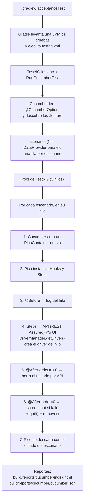
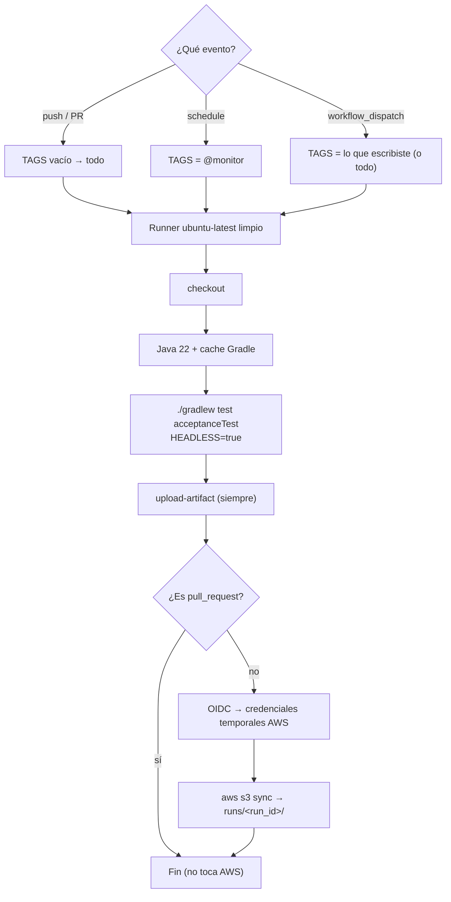
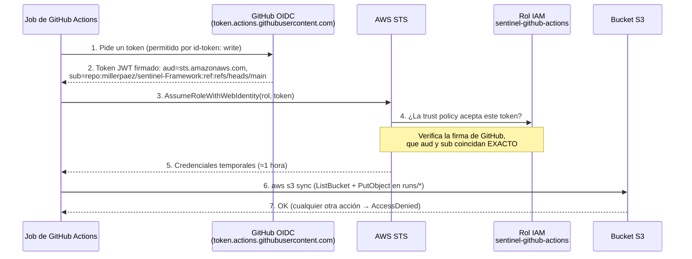

# Sentinel

[](https://github.com/millerpaez/sentinel-Framework/actions/workflows/ci.yml)

**Monitor sintético BDD en Java:** ejecuta los flujos críticos de [automationexercise.com](https://automationexercise.com) (UI y API) una vez al día, publica los reportes en AWS S3 y deja evidencia de cada fallo.

> 🚧 En construcción por fases. Cada sección se completa cuando termina la fase que la implementa.

---

## Stack y versiones

| Herramienta | Versión | Rol en el proyecto |
|---|---|---|
| Java | 22 | Lenguaje. Se compila con *toolchain* de Gradle a Java 22 |
| Gradle (wrapper) | 9.8.1 | Build y tareas (`test` para unit tests, `acceptanceTest` para BDD) |
| Selenium | 4.51.0 | Automatización UI. Selenium Manager descarga el driver de Chrome |
| Cucumber (`java`, `testng`, `picocontainer`) | 7.34.9 | BDD con Gherkin |
| TestNG | 7.12.0 | **Runner** de Cucumber, con escenarios en paralelo |
| JUnit | 5.14.4 | **Unit tests del propio framework** |
| PicoContainer | (vía `cucumber-picocontainer`) | Inyección de dependencias por escenario |
| REST Assured | 5.5.7 | Capa API: preparación y limpieza de datos, pruebas de API |
| Datafaker | 2.7.0 | Datos dinámicos (usuarios únicos por ejecución) |
| AssertJ | 3.27.7 | Aserciones con mensajes claros |

Se usan las versiones estables más recientes de cada librería **dentro de la versión mayor definida para el proyecto** (Cucumber 7, JUnit 5, REST Assured 5, AssertJ 3). Ya existen versiones mayores más nuevas de algunas, pero cambiar de versión mayor trae cambios incompatibles que no aportan nada a este alcance.

---

## Gradle en 2 minutos

### ¿Qué es?
Gradle es la herramienta de **build**: descarga dependencias, compila el código y ejecuta las pruebas. Todo se define en dos archivos:

| Archivo | Para qué |
|---|---|
| `settings.gradle` | Nombre del proyecto (`sentinel`) |
| `build.gradle` | Plugins, versión de Java, dependencias y tareas |

### ¿Qué es una tarea?
Una **tarea** es una unidad de trabajo con nombre: `compileTestJava`, `test`, `build`… Las tareas dependen unas de otras: `build` ejecuta la compilación y `check`, y `check` ejecuta `test`. Este proyecto define dos tareas de pruebas que nunca se mezclan:

| Tarea | Motor | Qué ejecuta |
|---|---|---|
| `test` | JUnit 5 | Unit tests del framework (`**/unit/**`) |
| `acceptanceTest` | TestNG + Cucumber | Escenarios BDD desde `testng.xml` |

`acceptanceTest` **no** forma parte de `build`: necesita red y navegador, así que se ejecuta de forma explícita.

### Wrapper vs. instalación global

| | Wrapper (`./gradlew`) | Global (`gradle`) |
|---|---|---|
| ¿Qué es? | Un script dentro del repo que descarga y usa **una versión fija** de Gradle | Gradle instalado en la máquina (por ejemplo con `brew install gradle`) |
| Versión | La que dice `gradle/wrapper/gradle-wrapper.properties` (9.8.1) | La que tenga instalada cada persona |
| ¿Hay que instalar algo? | No, solo Java | Sí |
| Resultado | Igual en todas las máquinas y en CI | Puede variar entre máquinas |

**Regla del proyecto:** siempre usar `./gradlew`. Así tu Mac, la de cualquier otra persona y GitHub Actions ejecutan exactamente la misma versión de Gradle. El wrapper además verifica el SHA-256 del Gradle que descarga.

Archivos del wrapper (todos se suben al repo):
- `gradlew` / `gradlew.bat`: scripts para macOS/Linux y Windows.
- `gradle/wrapper/gradle-wrapper.jar`: el pequeño programa que descarga Gradle.
- `gradle/wrapper/gradle-wrapper.properties`: versión y checksum.

La primera ejecución descarga Gradle en `~/.gradle/wrapper/dists`; las siguientes lo reutilizan.

### Comandos básicos

```bash
./gradlew build                  # compila y ejecuta los unit tests
./gradlew test                   # solo unit tests del framework (JUnit 5)
./gradlew acceptanceTest         # escenarios BDD (TestNG + Cucumber)
./gradlew tasks                  # lista las tareas disponibles
./gradlew dependencies --configuration testRuntimeClasspath   # árbol de dependencias
./gradlew clean                  # borra la carpeta build/
```

---

## Arquitectura

```
src/test/
├── java/com/miller/sentinel/
│   ├── core/                      # Reutilizable: NO conoce automationexercise
│   │   ├── config/Config.java
│   │   ├── driver/DriverFactory.java    # Crea ChromeDriver (headless o visible)
│   │   ├── driver/DriverManager.java    # ThreadLocal<WebDriver>: un navegador por hilo
│   │   ├── ui/BasePage.java             # Esperas explícitas y acciones comunes
│   │   └── api/ApiResult.java           # Normaliza respuestas (responseCode del body)
│   ├── app/                       # Específico del sitio bajo prueba
│   │   ├── pages/LoginPage.java, HomePage.java
│   │   ├── pages/components/HeaderComponent.java
│   │   ├── api/AutomationExerciseApi.java   # Todos los endpoints
│   │   ├── data/UserData.java (record), UserBuilder.java (Builder + Datafaker)
│   │   ├── context/ScenarioContext.java     # Estado por escenario (PicoContainer)
│   │   ├── hooks/Hooks.java
│   │   └── steps/ApiSteps.java, LoginSteps.java, CommonSteps.java
│   ├── runners/RunCucumberTest.java     # Cucumber sobre TestNG, escenarios en paralelo
│   └── unit/core/ConfigTest.java, UserBuilderTest.java   # Unit tests (JUnit 5)
└── resources/
    ├── config.properties, cucumber.properties, testng.xml
    └── features/
        ├── api/products.feature, api/verify_login.feature
        └── ui/login.feature
```

**`core` vs `app`:** `core` es infraestructura genérica (configuración, navegador, esperas, normalización de respuestas API) y no menciona el sitio bajo prueba. Para probar otro sitio se reemplaza `app` y `core` queda igual. `app` contiene todo lo que conoce automationexercise: páginas, locators, endpoints, datos, steps y hooks.

Todo vive en `src/test` porque el proyecto es un framework de pruebas, no una aplicación.

---

## Page Object Model (POM)

### Reglas
1. **Una clase por página o componente.** Una **página** es una URL (`/login` → `LoginPage`). Un **componente** es una parte de la interfaz que se repite en varias páginas (el header) y tiene su propia clase, `HeaderComponent`, que las páginas incluyen como atributo. Así el header se escribe una sola vez.
2. **Locators privados** (`private static final By`). Ningún `WebElement` sale del Page Object.
3. **Métodos de negocio, no técnicos:** `loginAs(email, password)`, no `typeEmail()` + `clickButton()`.
4. **Métodos fluidos:** si la acción lleva a otra página, devuelve el Page Object de esa página. `loginAs(...)` devuelve `HomePage` (login correcto) y `loginExpectingError(...)` devuelve `LoginPage` (el sitio no sale de `/login`).
5. **Sin aserciones en los pages:** exponen estado (`getErrorMessage()`, `isUserLoggedIn()`) y los steps deciden qué es correcto.
6. **`BasePage`** obtiene el driver de `DriverManager.getDriver()` y hace todas las acciones (`click`, `type`, `textOf`, `isVisible`) con `WebDriverWait`, usando el timeout de `Config`.
7. **Navegación directa por URL** (`/login`) en lugar de clics en el menú, porque los anuncios del sitio pueden interceptar esos clics.

### Ejemplo: página y componente
```java
public class LoginPage extends BasePage {
    private static final By EMAIL_INPUT = By.cssSelector("[data-qa='login-email']");
    private final HeaderComponent header = new HeaderComponent();   // composición

    public HomePage loginAs(String email, String password) {        // acción de negocio
        submitCredentials(email, password);
        return new HomePage();                                       // método fluido
    }
}

public class HeaderComponent extends BasePage {
    private static final By LOGOUT_LINK = By.cssSelector("header a[href='/logout']");
    public boolean isUserLoggedIn() { ... }                          // expone estado, no asevera
}
```

### ¿Por qué no hay aserciones en los pages?
- **Responsabilidad única:** el page sabe *cómo* interactuar con la pantalla y el step sabe *qué* se espera.
- **Reutilización:** el mismo `getErrorMessage()` sirve para una prueba que espera un error y para otra que espera que no haya ninguno. Si el page hiciera la aserción, se necesitaría un método distinto para cada expectativa.
- **Fallos claros:** la aserción vive en el step, que es justo donde Cucumber muestra el error en el reporte.

### Locators verificados contra el sitio real
Antes de escribir cada locator se revisó el HTML real con `curl`:

| Elemento | Locator | Fuente |
|---|---|---|
| Email / password / botón | `[data-qa='login-email' \| 'login-password' \| 'login-button']` | Atributos `data-qa` propios para automatización: no cambian con el diseño |
| Error de login | `.login-form form p` → `Your email or password is incorrect!` | Respuesta real de un login inválido |
| Usuario logueado | `//header//a[contains(., 'Logged in as')]/b` y `header a[href='/logout']` | Header real después de iniciar sesión |

---

## Modelo de hilos

### Dos mecanismos, dos responsabilidades

| Mecanismo | Qué guarda | Alcance | Por qué |
|---|---|---|---|
| `DriverManager` con `ThreadLocal<WebDriver>` | El navegador | **Por hilo** | El driver es un recurso pesado, ligado al hilo que lo usa. Cada hilo paralelo necesita su propio navegador |
| PicoContainer (`cucumber-picocontainer`) | `ScenarioContext` (usuario creado, última respuesta API), steps, hooks y el cliente API | **Por escenario** | Cucumber crea un contenedor nuevo por escenario, así que el estado nunca se filtra a otro escenario |

**¿Por qué ambos?** Porque resuelven problemas distintos. Un `ThreadLocal` solo no basta: el hilo se reutiliza entre escenarios y cualquier estado guardado ahí pasaría al siguiente escenario. Pico solo tampoco basta: el `WebDriver` no lo maneja Pico, y Selenium necesita que cada hilo use su propio navegador. Por eso: **hilo → navegador, escenario → estado**.

### `DriverManager`
```java
private static final ThreadLocal<WebDriver> DRIVER = new ThreadLocal<>();

public static WebDriver getDriver() {           // creación lazy
    WebDriver driver = DRIVER.get();
    if (driver == null) { driver = DriverFactory.createDriver(); DRIVER.set(driver); }
    return driver;
}

public static void quit() {
    try { if (DRIVER.get() != null) DRIVER.get().quit(); }
    finally { DRIVER.remove(); }                // SIEMPRE
}
```
- **Lazy:** el navegador se crea la primera vez que un page lo pide. Un escenario que solo usa la API nunca abre Chrome.
- **¿Por qué `remove()` es obligatorio?** TestNG usa un **pool de hilos que se reutilizan**. Sin `remove()`, el siguiente escenario que corre en ese hilo encuentra en el `ThreadLocal` el driver ya cerrado y falla con `NoSuchSessionException`. Además, el objeto nunca se libera y la memoria se acumula. Está dentro de un `finally` para que se ejecute aunque `quit()` lance una excepción.

### Paralelismo: cómo se configura
- `RunCucumberTest` sobrescribe `scenarios()` con `@DataProvider(parallel = true)`: cada escenario es una fila del DataProvider y TestNG reparte las filas entre los hilos de su pool.
- El número de hilos está en `src/test/resources/testng.xml`: `data-provider-thread-count="3"`.
- **Evidencia:** el `@Before` escribe en el reporte `running on thread: TestNG-PoolService-N`.

### Inyección con PicoContainer
Los steps y hooks reciben sus dependencias por constructor y Pico las crea:
```java
public ApiSteps(ScenarioContext context, AutomationExerciseApi api) { ... }
public LoginSteps(ScenarioContext context) { ... }
public Hooks(ScenarioContext context, AutomationExerciseApi api) { ... }
```
Dentro de un escenario, **las tres clases reciben la misma instancia** de `ScenarioContext`. Así, el usuario que crea `ApiSteps` lo usa `LoginSteps` para iniciar sesión y lo borra `Hooks` al final. En el siguiente escenario Pico crea instancias nuevas. Sin variables `static`, no hay forma de que dos escenarios paralelos compartan estado.

### Hooks
| Hook | Qué hace |
|---|---|
| `@Before` | Registra en el reporte el nombre del escenario y del hilo |
| `@After(order = 100)` | Si el escenario creó un usuario, lo borra por API. Si la limpieza falla, **no** marca la prueba como fallida: lo registra en el reporte |
| `@After(order = 0)` | Si el hilo tiene navegador: adjunta un screenshot si el escenario falló y luego `DriverManager.quit()` (con `remove()`) |

En Cucumber, los `@After` con **orden mayor se ejecutan primero**: primero se limpian los datos y después se cierra el navegador.

### Evidencia real (reporte de una ejecución)
```
products list            → TestNG-PoolService-1
verify login (404)       → TestNG-PoolService-2
verify login (400)       → TestNG-PoolService-3
invalid UI login         → TestNG-PoolService-3 / Browser closed on thread: TestNG-PoolService-3
hybrid API + UI          → TestNG-PoolService-2 / Cleanup: deleteAccount ... -> 200 Account deleted!
                                                / Browser closed on thread: TestNG-PoolService-2
```
- Hay 3 hilos distintos: los escenarios corren en paralelo.
- El hilo 3 ejecutó primero un escenario de API y después uno de UI. Esa **reutilización de hilos** es la razón por la que `remove()` es obligatorio.
- Solo los escenarios de UI cierran un navegador: los de API nunca lo abrieron (creación lazy).

### `DriverFactory`
- Usa solo `ChromeDriver`. **Selenium Manager** descarga el chromedriver que corresponde a la versión de Chrome instalada, así que no hay drivers manuales.
- `headless=true` agrega `--headless=new`, `--window-size=1920,1080`, `--no-sandbox` y `--disable-dev-shm-usage` (estos dos últimos son necesarios en contenedores Linux de CI).
- **`PageLoadStrategy.EAGER`:** Selenium devuelve el control cuando el DOM está listo, sin esperar a que terminen de cargar los anuncios y trackers del sitio. Las esperas explícitas de `BasePage` se encargan de los elementos que sí se usan.

---

## Flujo de ejecución completo



### Detalle de Gradle 9 + TestNG
`RunCucumberTest` no declara ningún `@Test` propio: lo hereda de `AbstractTestNGCucumberTests`, que está dentro del jar de Cucumber. El escáner de clases de Gradle no lo detecta y Gradle 9 falla con *"did not discover any tests"*. Por eso `acceptanceTest` usa `scanForTestClasses = false` e `include '**/runners/**'`. La clase que se ejecuta ya la define `testng.xml`.

---

## Configuración (`Config`)

### Qué
`core/config/Config.java` es el único punto de acceso a la configuración. Los valores por defecto viven en `src/test/resources/config.properties`:

| Clave | Valor por defecto | Variable de entorno |
|---|---|---|
| `base.url` | `https://automationexercise.com` | `BASE_URL` |
| `api.base.url` | `https://automationexercise.com/api` | `API_BASE_URL` |
| `headless` | `false` | `HEADLESS` |
| `timeout.seconds` | `10` | `TIMEOUT_SECONDS` |

### Orden de precedencia (gana el primero que exista)

1. **System property:** `./gradlew ... -Dheadless=true`
2. **Variable de entorno:** la clave en mayúsculas y con `.` cambiado por `_` (`headless` → `HEADLESS`)
3. **`config.properties`**

Si la clave no existe en ninguno de los tres, se lanza `IllegalStateException` con el nombre de la clave. Es mejor fallar de inmediato que seguir con un `null`.

### Por qué así
- **El mismo código en local y en CI:** en tu Mac se usan los valores del archivo y en GitHub Actions se cambian con `HEADLESS=true`, sin tocar código.
- **El archivo se lee una sola vez** (inicialización estática) y nadie puede modificarlo después. La clase es `final` y tiene constructor privado, así que no se crean instancias: todo se hace con `Config.get(...)`.
- **Conversión estricta de tipos:** `getBool` solo acepta `true` o `false` (sin importar mayúsculas). `Boolean.parseBoolean("yes")` devolvería `false` sin avisar, y un error de escritura como `HEADLESS=ture` dejaría el navegador visible en CI sin que nadie lo notara. `getInt` muestra un error que incluye el nombre de la clave.

### Cómo se prueba (`ConfigTest`, JUnit 5)
Son 9 unit tests: lectura del archivo, system property por encima del archivo, uso de la variable de entorno, system property por encima de la variable de entorno, conversión de `int` y `boolean`, valores inválidos y clave faltante.

- Las variables de entorno no se pueden modificar desde Java. Por eso la prueba usa la clave `home`, que corresponde a la variable `HOME` y existe tanto en macOS como en el runner de CI.
- `@AfterEach` borra las system properties que cada prueba define, para que ninguna prueba afecte a otra.
- Las pruebas no dependen del entorno: dan el mismo resultado con `HEADLESS=true` (como en CI).

---

## Manejo de datos

### `UserData` (record)
Un `record` inmutable con los 17 campos que exige `POST /api/createAccount`. Los componentes del record usan camelCase de Java (`birthDate`) y `toFormParams()` devuelve un `Map` con los nombres exactos que espera la API (`birth_date`, `mobile_number`…). **Por qué record:** es inmutable (ningún step puede modificar el usuario a mitad del escenario) y `equals`, `hashCode` y `toString` vienen gratis.

### `UserBuilder` (Builder + Datafaker)
```java
UserData user = UserBuilder.aUser().build();                        // todo aleatorio y válido
UserData user = UserBuilder.aUser().withPassword("Secret123").build(); // solo cambia lo que importa
```
- **Valores por defecto aleatorios** con Datafaker: nombre, dirección, empresa, etc. Cada prueba indica solo lo que le importa.
- **Email único:** `sentinel-<12 caracteres de un UUID>@sentinel.test`. Dos hilos en paralelo o dos ejecuciones del cron nunca usan la misma cuenta. El dominio `.test` está reservado y nunca existe, así que no se envían correos a nadie.
- **Valores que el sitio acepta** (verificados en el formulario real de registro): `country` sale de la lista del select (India, United States, Canada, Australia, Israel, New Zealand, Singapore), `title` es `Mr` o `Mrs` y el mes va de 1 a 12.

### `UserBuilderTest` (JUnit 5)
Valida que los emails sean únicos entre usuarios, que la sobrescritura cambie solo los campos pedidos, que estén los 17 campos y ninguno vacío, y que el país pertenezca a la lista aceptada.

### Datos de casos negativos: `Examples`
Los casos inválidos viven en la tabla `Examples` del `Scenario Outline`, dentro del `.feature`. Así son visibles para negocio y agregar un caso es agregar una fila, sin tocar Java.

---

## Capa API

### `AutomationExerciseApi`
Es el único lugar que usa REST Assured: los steps nunca lo llaman directamente. Tiene un `RequestSpecification` base con `baseUri` desde `Config` y `ContentType.URLENC`, porque la API recibe parámetros de formulario, no JSON.

| Método | Endpoint |
|---|---|
| `getProductsList()` | `GET /productsList` |
| `verifyLogin(email, password)` | `POST /verifyLogin` |
| `createAccount(UserData)` | `POST /createAccount` |
| `deleteAccount(email, password)` | `DELETE /deleteAccount` |

### La peculiaridad de esta API (verificada con `curl -i`)
```
$ curl -i -X POST .../api/verifyLogin -d "email=nobody@sentinel.test&password=wrong123"
HTTP/2 200
content-type: text/html; charset=utf-8
{"responseCode": 404, "message": "User not found!"}
```
1. **El HTTP status casi siempre es 200**, aunque la operación falle. El resultado real está en el campo `responseCode` del body.
2. **El `Content-Type` es `text/html`** aunque el body sea JSON. REST Assured no lo interpretaría como JSON de forma automática.

**Solución: `ApiResult`** (record en `core/api`). Parsea el body desde `response.asString()`, sin importar el Content-Type, y expone `httpStatus`, `responseCode`, `message` y el `JsonPath` completo. Los steps validan siempre `responseCode` y no necesitan conocer la peculiaridad.

### Parámetro ausente ≠ parámetro vacío
| Request | Respuesta real |
|---|---|
| sin `email` | `400 Bad request, email or password parameter is missing in POST request.` |
| `email=` (vacío) | `404 User not found!` |

Por eso `verifyLogin` **omite** los parámetros en blanco. En el `.feature`, una celda vacía significa "no enviar el parámetro".

---

## Escenarios y tags

| Escenario | Tipo | Tags | Qué valida |
|---|---|---|---|
| The products list returns available products | API | `@api @smoke` | `responseCode` 200 y catálogo no vacío |
| Invalid login requests are rejected (usuario inexistente) | API | `@api` | 404 `User not found!` |
| Invalid login requests are rejected (sin email) | API | `@api` | 400 parámetro faltante |
| Login with invalid credentials shows an error | UI | `@ui @smoke` | Mensaje de error y usuario sin sesión |
| A user registered through the API can log in through the UI | **Híbrido** | `@ui @smoke @monitor` | Usuario creado por API, login por UI, header muestra `Logged in as <nombre>`, limpieza por API |

**Significado de cada tag:**
- `@api`: solo API, **nunca abre navegador**.
- `@ui`: usa navegador.
- `@smoke`: verificación rápida de lo esencial.
- `@monitor`: lo que ejecuta el job programado una vez al día.

El híbrido **no** lleva `@api`, aunque prepare datos por API. Así `-Dtags="@api"` garantiza que no se abre Chrome.

### ¿Por qué el escenario híbrido?
- **Preparar datos por API** tarda menos de un segundo y es estable. Registrar un usuario por UI son 3 pantallas y unos 15 campos, cada uno con riesgo de fallar por anuncios o por tiempos de carga.
- **Validar por UI** lo que de verdad ve el usuario: que puede iniciar sesión.
- **Limpiar por API** en el `@After`: no quedan cuentas basura en el sitio, aunque el escenario falle.

---

## Cómo ejecutar localmente (macOS)

**Requisitos:** Java 22, Google Chrome y Git. Gradle **no** hace falta: lo trae el wrapper.

```bash
java -version                              # debe mostrar 22
./gradlew build                            # compila y ejecuta los unit tests
./gradlew test                             # unit tests del framework (JUnit 5)
./gradlew acceptanceTest                   # escenarios BDD con Chrome visible
HEADLESS=true ./gradlew acceptanceTest     # sin ventana, como en CI
./gradlew acceptanceTest -Dtags="@api"     # solo API (no abre navegador)
./gradlew acceptanceTest -Dtags="@monitor" # lo que ejecuta el job programado
HEADLESS=true ./gradlew test acceptanceTest   # todo, como en CI
```

Reporte: abrir `build/reports/cucumber/index.html` en el navegador.

---

## CI (GitHub Actions)

Workflow: [`.github/workflows/ci.yml`](.github/workflows/ci.yml). El badge al inicio del README muestra el estado de la última ejecución en `main`: verde si pasó y rojo si falló.

### Conceptos básicos (vocabulario)

| Concepto | Qué es | En este proyecto |
|---|---|---|
| **Workflow** | Un archivo YAML en `.github/workflows/` que describe una automatización | `ci.yml` |
| **Evento (trigger)** | Lo que hace que el workflow arranque | `push`, `pull_request`, `schedule`, `workflow_dispatch` |
| **Job** | Un grupo de pasos que corre en **una** máquina | Un solo job: `test` |
| **Runner** | La máquina virtual que GitHub presta para ejecutar el job. Se crea limpia en cada ejecución y se destruye al terminar | `ubuntu-latest` (trae Chrome, Java y AWS CLI preinstalados) |
| **Step** | Un paso del job. Puede ser `uses:` (una *action* ya hecha por alguien) o `run:` (comandos de shell) | 6 steps |
| **Action** | Un paso reutilizable publicado en GitHub, con versión (`@v7`) | `actions/checkout`, `actions/setup-java`, `actions/upload-artifact`, `aws-actions/configure-aws-credentials` |
| **Expresión** | Código entre `${{ }}` que GitHub evalúa **antes** de ejecutar el paso | `${{ github.run_id }}`, `${{ secrets.AWS_ROLE_ARN }}` |
| **Contexto** | Objetos de datos disponibles en las expresiones | `github` (evento, run id…), `secrets`, `inputs` |
| **`if:`** | Condición para ejecutar un step. Por defecto un step **solo corre si todos los anteriores pasaron** | `if: always()` lo ejecuta aunque las pruebas fallen |
| **Artifact** | Archivos que el job guarda al terminar y que se descargan desde la página de la ejecución | `sentinel-reports-<run_id>` |
| **Secret** | Valor guardado cifrado en GitHub. No aparece en el código y GitHub lo oculta (`***`) en los logs | `AWS_ROLE_ARN`, `REPORT_BUCKET` |

### Recorrido del archivo, bloque por bloque

**1. Cuándo se ejecuta (`on:`)**
```yaml
on:
  push:
    branches: [main]        # cada push a main
  pull_request:             # cada PR (hacia cualquier rama)
  schedule:
    - cron: "0 1 * * *"     # una vez al día (UTC)
  workflow_dispatch:        # botón manual "Run workflow"
    inputs:
      tags: ...             # campo opcional para elegir tags
```

| Evento | Cuándo | Qué ejecuta | ¿Publica en S3? |
|---|---|---|---|
| `push` | Push a `main` | Todo: unit tests + todos los escenarios | Sí |
| `pull_request` | Cada PR | Todo (evita que entre código roto a `main`) | **No** (ver sección AWS) |
| `schedule` | Una vez al día | Solo `@monitor`: **el monitor sintético** | Sí |
| `workflow_dispatch` | Manual | Todo, o el tag que escribas en `tags` | Sí |

**2. Permisos (`permissions:`)**
```yaml
permissions:
  contents: read      # puede leer el código del repo, nada más
  id-token: write     # puede pedir a GitHub un token OIDC (para AWS)
```
Cada job recibe un token temporal de GitHub (`GITHUB_TOKEN`). Declarar `permissions` limita lo que ese token puede hacer. Aquí puede leer el código y pedir el token OIDC, nada más: no puede escribir en el repo, crear releases ni comentar en PRs. A esto se le llama **mínimo privilegio**.

`id-token: write` **no** da acceso a AWS por sí solo. Solo permite pedir un "documento de identidad" firmado por GitHub. Es AWS quien decide si confía en él (ver sección AWS).

**3. El job**
```yaml
jobs:
  test:
    runs-on: ubuntu-latest
    timeout-minutes: 20      # si algo se cuelga, GitHub lo mata a los 20 min
```

**4. Los pasos**

| # | Step | Qué hace | Detalle |
|---|---|---|---|
| 1 | `actions/checkout@v7` | Descarga el código del repo en el runner | El runner empieza vacío |
| 2 | `actions/setup-java@v6` | Instala Java 22 (Temurin) | `cache: gradle` guarda `~/.gradle` entre ejecuciones (Gradle, dependencias): la segunda ejecución es mucho más rápida |
| 3 | `Run unit tests and BDD scenarios` | `./gradlew test acceptanceTest` | `HEADLESS=true` como variable de entorno: gracias a la precedencia de `Config`, sobrescribe `headless=false` del archivo sin tocar código. Chrome ya viene en el runner y Selenium Manager descarga el chromedriver correspondiente |
| 4 | `actions/upload-artifact@v7` | Sube `build/reports` como artifact (14 días) | `if: always()`: se sube **también si las pruebas fallaron**, que es cuando más se necesita la evidencia (screenshot incluido) |
| 5 | `aws-actions/configure-aws-credentials@v6` | Cambia el token OIDC por credenciales temporales de AWS | Ver sección AWS |
| 6 | `Publish Cucumber report to S3` | `aws s3 sync` del reporte a `s3://<bucket>/runs/<run_id>/` | Si no se generó reporte (por ejemplo, falló la compilación), termina sin error |

**5. Cómo se eligen los tags**
```yaml
TAGS: ${{ github.event_name == 'schedule' && '@monitor' || inputs.tags || '' }}
```
Se lee como un "si / si no" encadenado:
- Si el evento es `schedule` → `@monitor`.
- Si no, si alguien escribió tags al lanzarlo manualmente → esos tags.
- Si no → vacío.

Luego el script de shell decide:
```bash
if [ -n "$TAGS" ]; then            # -n = "no está vacío"
  ./gradlew test acceptanceTest -Dtags="$TAGS"
else
  ./gradlew test acceptanceTest    # todo
fi
```

### Flujo del job



### El cron, en detalle

Un cron tiene **5 campos**: `minuto hora día-del-mes mes día-de-la-semana`. Un `*` significa "cualquiera".

```
0 1 * * *
│ │ │ │ └── cualquier día de la semana
│ │ │ └──── cualquier mes
│ │ └────── cualquier día del mes
│ └──────── hora 1
└────────── minuto 0
```
→ **Todos los días a las 01:00 UTC.**

**El cron de GitHub siempre está en UTC.** Colombia es UTC-5 todo el año (no cambia de horario), así que:

| UTC | Colombia |
|---|---|
| 01:00 | **20:00 del día anterior** |

Cosas que conviene saber del `schedule`:
- **Solo corre en la rama por defecto** (`main`). Un cron en otra rama no hace nada.
- **Puede retrasarse** de minutos a más de una hora cuando GitHub tiene mucha carga. Es normal y no indica un error.
- **GitHub desactiva los workflows programados** de un repo público después de **60 días sin actividad** en el repo. Si pasa, se reactiva desde la pestaña Actions.
- El primer cron se ejecuta en la siguiente 01:00 UTC después de que el archivo llegue a `main`.

### Cómo lanzarlo manualmente

**Desde la web:** GitHub → pestaña **Actions** → workflow **CI** (columna izquierda) → botón **Run workflow** → rama `main` → en `tags`, opcionalmente `@monitor` → **Run workflow**.

**Desde la terminal** (con [GitHub CLI](https://cli.github.com/)):
```bash
gh workflow run ci.yml                      # todo
gh workflow run ci.yml -f tags="@monitor"   # solo el monitor
gh run watch                                # seguir la ejecución en vivo
```

### Dónde ver los resultados

| Qué | Dónde |
|---|---|
| Estado general | Badge del README, o el ✅/❌ junto a cada commit |
| Lista de ejecuciones | Pestaña **Actions** → workflow **CI** |
| Logs de cada paso | Abrir una ejecución → job `test` → expandir el step |
| Reporte Cucumber (GitHub) | Abrir una ejecución → sección **Artifacts** (abajo) → descargar `sentinel-reports-<run_id>` → descomprimir → abrir `cucumber/index.html` |
| Reporte Cucumber (S3) | Ver sección AWS → "Cómo ver los reportes en S3" |
| Ruta exacta en S3 | En el **Summary** de la ejecución aparece `Report published to s3://...` |

Desde la terminal:
```bash
gh run list --limit 5                       # últimas ejecuciones
gh run view <run_id> --log-failed           # solo los logs de lo que falló
gh run download <run_id>                    # descarga el artifact
```

### ¿Qué pasa cuando algo falla?
1. El step de pruebas termina en rojo (Gradle sale con código ≠ 0).
2. Aun así, `upload-artifact` sube el reporte (`if: always()`), con el **screenshot** del fallo adjunto en el escenario.
3. Aun así, el reporte se publica en S3.
4. El job y el badge quedan en rojo, y GitHub envía un correo al dueño del repo (configurable en GitHub → Settings → Notifications).

---

## AWS: reportes en S3 con OIDC

### Qué se construye

Cada ejecución en `main` sube su reporte Cucumber a:
```
s3://sentinel-reports-millerpaez/runs/<run_id>/index.html
s3://sentinel-reports-millerpaez/runs/<run_id>/cucumber.json
```
Así queda un **historial** de todas las ejecuciones del monitor fuera de GitHub, que no expira a los 14 días como los artifacts.

### Vocabulario de AWS

| Concepto | Qué es (en simple) |
|---|---|
| **S3** | Servicio de almacenamiento de archivos. Un **bucket** es una "carpeta raíz" con nombre único en todo AWS |
| **Región** | Centro de datos donde vive el recurso. Aquí: `us-east-1` (Virginia) |
| **IAM** | Servicio de identidades y permisos de AWS: **quién** puede hacer **qué** sobre **cuál** recurso |
| **Rol IAM** | Una identidad **sin contraseña ni llaves** que alguien de confianza puede "asumir" temporalmente |
| **Política de confianza** (*trust policy*) | Define **quién puede asumir** el rol |
| **Política de permisos** | Define **qué puede hacer** quien asumió el rol |
| **ARN** | El "nombre completo" único de cualquier recurso de AWS, por ejemplo `arn:aws:iam::146183084500:role/sentinel-github-actions` |
| **Proveedor de identidad OIDC** | Un registro en IAM que le dice a AWS "confío en los tokens firmados por este emisor" (aquí, GitHub) |
| **STS** | Servicio que entrega **credenciales temporales** a quien asume un rol |

### OIDC explicado

**Problema:** para subir archivos a S3, GitHub Actions necesita credenciales de AWS. La forma antigua es crear llaves permanentes (access key + secret) y guardarlas en GitHub. Si esas llaves se filtran, sirven para siempre hasta que alguien las revoque.

**Solución OIDC (OpenID Connect):** AWS confía en GitHub como "proveedor de identidad". En cada ejecución, GitHub emite un token firmado que dice "soy el workflow del repo `millerpaez/sentinel-Framework`". AWS verifica la firma, revisa que el repo coincida con la condición del rol y entrega **credenciales temporales** (expiran en minutos). No existe ninguna llave guardada.

**Analogía:** es como entrar a un edificio. Las llaves IAM son una copia de la llave de la puerta: si la pierdes, quien la encuentre entra cuando quiera. OIDC es mostrar tu cédula en recepción (el token firmado por GitHub). La recepción (AWS) verifica que la cédula sea auténtica y que estés en la lista (la condición del rol), y te da un **pase de visitante que vence en una hora** (las credenciales temporales).

### Paso a paso de lo que ocurre en cada ejecución



1. El step `configure-aws-credentials` pide a GitHub un token OIDC. Solo puede hacerlo porque el workflow tiene `id-token: write`.
2. GitHub entrega un **JWT** (un JSON firmado digitalmente) con *claims* (datos) sobre quién lo pide. Los dos que importan son:
   - `aud` (audiencia): `sts.amazonaws.com`, es decir, "este token es para AWS".
   - `sub` (sujeto): `repo:millerpaez/sentinel-Framework:ref:refs/heads/main`, es decir, "soy este repo, en esta rama".
3. El step llama a AWS STS, `AssumeRoleWithWebIdentity`, con el ARN del rol y el token.
4. AWS revisa la **trust policy** del rol: que la firma sea de GitHub y que `aud` y `sub` coincidan exactamente.
5. Si todo coincide, STS devuelve credenciales temporales. El step las guarda como variables de entorno y los siguientes pasos del job (el `aws s3 sync`) las usan automáticamente.
6. `aws s3 sync` sube el reporte. Solo puede listar el bucket y escribir dentro de `runs/`: no puede borrar ni leer nada.

### Los dos archivos de `infra/iam/`, línea por línea

**[`infra/iam/trust-policy.json`](infra/iam/trust-policy.json): quién puede asumir el rol**
```json
{
  "Version": "2012-10-17",                                   // versión del lenguaje de políticas (siempre esta)
  "Statement": [{
    "Effect": "Allow",
    "Principal": {                                           // QUIÉN: tokens del proveedor OIDC de GitHub
      "Federated": "arn:aws:iam::146183084500:oidc-provider/token.actions.githubusercontent.com"
    },
    "Action": "sts:AssumeRoleWithWebIdentity",               // asumir el rol presentando un token web
    "Condition": {
      "StringEquals": {                                      // coincidencia EXACTA (distingue mayúsculas)
        "token.actions.githubusercontent.com:aud": "sts.amazonaws.com",
        "token.actions.githubusercontent.com:sub": "repo:millerpaez/sentinel-Framework:ref:refs/heads/main"
      }
    }
  }]
}
```
(Los comentarios `//` son solo explicativos: JSON no admite comentarios y el archivo real no los tiene.)

**La condición `sub` es la que da la seguridad.** Sin ella, **cualquier repositorio de GitHub del mundo** podría asumir el rol, porque todos los tokens los firma el mismo emisor. Con ella, solo puede asumirlo:
- el repo `millerpaez/sentinel-Framework` (no un fork, no otro repo),
- y solo en la rama `main` (`push` a main, `schedule` y `workflow_dispatch` lanzados desde main).

Un PR genera un `sub` distinto (`repo:millerpaez/sentinel-Framework:pull_request`), así que AWS lo rechazaría. Por eso además los pasos de AWS tienen `if: github.event_name != 'pull_request'`: ni siquiera lo intentan. Esto importa porque un PR puede venir de un desconocido con código malicioso.

**[`infra/iam/s3-report-policy.json`](infra/iam/s3-report-policy.json): qué puede hacer el rol**
```json
{
  "Version": "2012-10-17",
  "Statement": [
    { "Sid": "ListReportBucket",                             // listar el contenido del bucket
      "Effect": "Allow",
      "Action": "s3:ListBucket",
      "Resource": "arn:aws:s3:::sentinel-reports-millerpaez" },        // el bucket (sin /*)
    { "Sid": "UploadReportsUnderRuns",                       // subir archivos...
      "Effect": "Allow",
      "Action": "s3:PutObject",
      "Resource": "arn:aws:s3:::sentinel-reports-millerpaez/runs/*" }  // ...solo dentro de runs/
  ]
}
```
- `aws s3 sync` necesita **`ListBucket`** para comparar qué hay en el destino y **`PutObject`** para subir.
- `ListBucket` se aplica al **bucket** (ARN sin `/*`) y `PutObject` a los **objetos** (ARN con `/...`). Es una regla de S3 y un error muy común.
- `PutObject` está limitado a `runs/*`, aún más restringido que todo el bucket.
- **No** tiene `DeleteObject` ni `GetObject`: aunque alguien robara las credenciales temporales durante su hora de vida, no podría borrar el historial ni leer nada.

### Configuración en la consola de AWS (paso a paso)

> Haz los pasos en este orden. Inicia sesión en https://console.aws.amazon.com con la cuenta `millerAWS` (ID `146183084500`) y, arriba a la derecha, selecciona la región **N. Virginia (us-east-1)**.

**Paso 1: presupuesto (protección de costos). Hazlo primero.**
1. Buscador superior → **Billing and Cost Management** → menú izquierdo **Budgets** → **Create budget**.
2. Elige **Use a template** → **Monthly cost budget**.
3. Nombre: `sentinel-budget`. Monto: **5.00 USD**. Email: tu correo.
4. **Create budget**. AWS te enviará un correo si el gasto se acerca a 5 USD.

**Paso 2: bucket S3**
1. Buscador → **S3** → **Create bucket**.
2. **Bucket type:** General purpose. **Bucket name:** `sentinel-reports-millerpaez`.
3. **Region:** `us-east-1`.
4. **Object Ownership:** ACLs disabled (por defecto).
5. **Block all public access:** ✅ **activado** (por defecto). Los reportes son privados.
6. Lo demás por defecto (cifrado SSE-S3 activado) → **Create bucket**.

**Paso 3: proveedor de identidad OIDC (una sola vez por cuenta)**
1. Buscador → **IAM** → menú izquierdo **Identity providers** → **Add provider**.
2. **Provider type:** OpenID Connect.
3. **Provider URL:** `https://token.actions.githubusercontent.com`.
4. **Audience:** `sts.amazonaws.com`.
5. **Add provider**. Su ARN queda como `arn:aws:iam::146183084500:oidc-provider/token.actions.githubusercontent.com`, que es exactamente el que aparece en `trust-policy.json`.

**Paso 4: rol IAM**
1. IAM → **Roles** → **Create role**.
2. **Trusted entity type:** Web identity.
3. **Identity provider:** `token.actions.githubusercontent.com`. **Audience:** `sts.amazonaws.com`.
4. Llena los campos de GitHub:
   - **GitHub organization:** `millerpaez`
   - **GitHub repository:** `sentinel-Framework` (con la **F mayúscula**, exactamente igual)
   - **GitHub branch:** `main`
5. **Next** → en *Add permissions* **no** marques nada → **Next**.
6. **Role name:** `sentinel-github-actions` → **Create role**.
7. Abre el rol → pestaña **Trust relationships** → **Edit trust policy** → reemplaza todo con el contenido de [`infra/iam/trust-policy.json`](infra/iam/trust-policy.json) → **Update policy**. Así queda exactamente igual al archivo del repo, sin depender de lo que generó el asistente.

**Paso 5: permisos del rol (política en línea)**
1. En el rol → pestaña **Permissions** → **Add permissions** → **Create inline policy**.
2. Cambia el editor a **JSON**, borra lo que haya y pega el contenido de [`infra/iam/s3-report-policy.json`](infra/iam/s3-report-policy.json).
3. **Next** → nombre: `sentinel-s3-reports` → **Create policy**.
4. En la página del rol, copia el **ARN** (arriba): `arn:aws:iam::146183084500:role/sentinel-github-actions`.

**Paso 6: secrets en GitHub**
1. GitHub → repo `sentinel-Framework` → **Settings** → **Secrets and variables** → **Actions** → **New repository secret**.
2. Crea dos secrets:

| Name | Secret |
|---|---|
| `AWS_ROLE_ARN` | `arn:aws:iam::146183084500:role/sentinel-github-actions` |
| `REPORT_BUCKET` | `sentinel-reports-millerpaez` |

> Ninguno de los dos es una contraseña: sin el token OIDC de **este** repo no sirven para nada. Se guardan como secrets para no dejar el número de cuenta ni el nombre del bucket en el código ni en los logs.

**Paso 7: probar**
1. GitHub → **Actions** → **CI** → **Run workflow** (rama `main`).
2. Cuando termine, revisa que los steps **Configure AWS credentials (OIDC)** y **Publish Cucumber report to S3** estén en verde.
3. En el **Summary** de la ejecución aparece `Report published to s3://sentinel-reports-millerpaez/runs/<run_id>/`.

### Cómo ver los reportes en S3
1. Consola → **S3** → `sentinel-reports-millerpaez` → carpeta `runs/` → carpeta con el `run_id` (el mismo número que aparece en la URL de la ejecución en GitHub).
2. Selecciona `index.html` → **Download** → ábrelo en el navegador. El reporte de Cucumber es un solo archivo HTML autocontenido, así que funciona sin conexión.

El bucket es **privado**: no hay URL pública. Es intencional (sección 14, roadmap: "sitio estático público en S3").

### El workflow, parte AWS
```yaml
- name: Configure AWS credentials (OIDC)
  if: always() && github.event_name != 'pull_request'
  uses: aws-actions/configure-aws-credentials@v6
  with:
    role-to-assume: ${{ secrets.AWS_ROLE_ARN }}   # qué rol asumir
    aws-region: us-east-1

- name: Publish Cucumber report to S3
  if: always() && github.event_name != 'pull_request'
  env:
    REPORT_BUCKET: ${{ secrets.REPORT_BUCKET }}
  run: |
    if [ ! -d build/reports/cucumber ]; then exit 0; fi   # no hay reporte → nada que subir
    aws s3 sync build/reports/cucumber "s3://${REPORT_BUCKET}/runs/${{ github.run_id }}/"
```
- `if: always()`: el reporte se publica **aunque las pruebas fallen**. Un monitor que solo guarda evidencia de los éxitos no sirve.
- No hay ninguna llave en el YAML: `role-to-assume` es solo el **nombre** del rol. La "prueba de identidad" es el token OIDC, que la action pide sola.
- `aws s3 sync` sube solo lo que no existe o cambió. Como cada ejecución usa una carpeta nueva (`runs/<run_id>/`), en la práctica sube todo y nunca sobrescribe ejecuciones anteriores.
- La AWS CLI ya viene instalada en `ubuntu-latest`.

### Costos
Cada reporte pesa unos cientos de KB. Con una ejecución programada al día más los pushes, en un año son unos cientos de MB: centavos de dólar en S3. Las llamadas a IAM, STS y OIDC son gratuitas. El presupuesto de 5 USD es solo una red de seguridad.

### Solución de problemas

| Error en el log | Causa probable | Arreglo |
|---|---|---|
| `Not authorized to perform sts:AssumeRoleWithWebIdentity` | El `sub` del token no coincide con la trust policy: mayúsculas (`sentinel-Framework`), rama distinta de `main`, o el proveedor OIDC no existe | Revisar el paso 3 y la pestaña *Trust relationships* del rol contra `trust-policy.json` |
| `Credentials could not be loaded` / `Could not get ID token` | Falta `id-token: write` en `permissions` | Verificar el bloque `permissions` del workflow |
| `Input required and not supplied: role-to-assume` | El secret `AWS_ROLE_ARN` no existe o tiene otro nombre | Paso 6 |
| `AccessDenied ... s3:PutObject` | La política en línea no está adjunta, o el bucket o la ruta no coinciden | Paso 5; el ARN debe terminar en `/runs/*` |
| `AccessDenied ... s3:ListBucket` | El ARN de `ListBucket` tiene `/*` o el nombre del bucket está mal | Debe ser exactamente `arn:aws:s3:::sentinel-reports-millerpaez` |
| `NoSuchBucket` | El nombre en el secret `REPORT_BUCKET` no coincide con el bucket creado | Paso 2 y paso 6 |

### Plan B: llaves IAM (solo si OIDC no funciona a tiempo)
1. IAM → **Users** → **Create user** → nombre `sentinel-ci` → sin acceso a consola.
2. **Permissions:** adjuntar como política en línea el mismo `s3-report-policy.json`.
3. Usuario → **Security credentials** → **Create access key** → *Application running outside AWS* → copiar las dos llaves (solo se muestran una vez).
4. GitHub secrets: `AWS_ACCESS_KEY_ID` y `AWS_SECRET_ACCESS_KEY`.
5. En el workflow, cambiar `role-to-assume` por:
   ```yaml
   aws-access-key-id: ${{ secrets.AWS_ACCESS_KEY_ID }}
   aws-secret-access-key: ${{ secrets.AWS_SECRET_ACCESS_KEY }}
   ```

**Por qué es solo un plan B:** son llaves **permanentes**. Si se filtran, sirven hasta que alguien las revoque, y hay que rotarlas a mano. Con OIDC no existe nada que se pueda filtrar.
