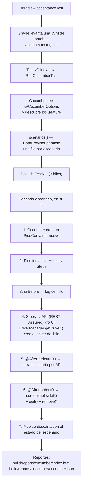

# Sentinel

[](https://github.com/millerpaez/sentinel-Framework/actions/workflows/ci.yml)

**Monitor sintético BDD en Java:** ejecuta los flujos críticos de [automationexercise.com](https://automationexercise.com) (UI y API) cada 6 horas, publica los reportes en AWS S3 y deja evidencia de cada fallo.

> 🚧 En construcción por fases. Cada sección se completa cuando termina la fase que la implementa.

---

## Stack y versiones

| Herramienta | Versión | Rol en el proyecto |
|---|---|---|
| Java | 22 | Lenguaje. Se compila con *toolchain* de Gradle a Java 22 |
| Gradle (wrapper) | 9.8.1 | Build y tareas (`test` para unit tests, `acceptanceTest` para BDD) |
| Selenium | 4.51.0 | Automatización UI. Selenium Manager descarga el driver de Chrome |
| Cucumber (`java`, `testng`, `picocontainer`) | 7.34.9 | BDD con Gherkin |
| TestNG | 7.12.0 | **Runner** de Cucumber, con escenarios en paralelo |
| JUnit | 5.14.4 | **Unit tests del propio framework** |
| PicoContainer | (vía `cucumber-picocontainer`) | Inyección de dependencias por escenario |
| REST Assured | 5.5.7 | Capa API: preparación y limpieza de datos, pruebas de API |
| Datafaker | 2.7.0 | Datos dinámicos (usuarios únicos por ejecución) |
| AssertJ | 3.27.7 | Aserciones con mensajes claros |

Se usan las versiones estables más recientes de cada librería **dentro de la versión mayor definida para el proyecto** (Cucumber 7, JUnit 5, REST Assured 5, AssertJ 3). Ya existen versiones mayores más nuevas de algunas, pero cambiar de versión mayor trae cambios incompatibles que no aportan nada a este alcance.

---

## Gradle en 2 minutos

### ¿Qué es?
Gradle es la herramienta de **build**: descarga dependencias, compila el código y ejecuta las pruebas. Todo se define en dos archivos:

| Archivo | Para qué |
|---|---|
| `settings.gradle` | Nombre del proyecto (`sentinel`) |
| `build.gradle` | Plugins, versión de Java, dependencias y tareas |

### ¿Qué es una tarea?
Una **tarea** es una unidad de trabajo con nombre: `compileTestJava`, `test`, `build`… Las tareas dependen unas de otras: `build` ejecuta la compilación y `check`, y `check` ejecuta `test`. Este proyecto define dos tareas de pruebas que nunca se mezclan:

| Tarea | Motor | Qué ejecuta |
|---|---|---|
| `test` | JUnit 5 | Unit tests del framework (`**/unit/**`) |
| `acceptanceTest` | TestNG + Cucumber | Escenarios BDD desde `testng.xml` |

`acceptanceTest` **no** forma parte de `build`: necesita red y navegador, así que se ejecuta de forma explícita.

### Wrapper vs. instalación global

| | Wrapper (`./gradlew`) | Global (`gradle`) |
|---|---|---|
| ¿Qué es? | Un script dentro del repo que descarga y usa **una versión fija** de Gradle | Gradle instalado en la máquina (por ejemplo con `brew install gradle`) |
| Versión | La que dice `gradle/wrapper/gradle-wrapper.properties` (9.8.1) | La que tenga instalada cada persona |
| ¿Hay que instalar algo? | No, solo Java | Sí |
| Resultado | Igual en todas las máquinas y en CI | Puede variar entre máquinas |

**Regla del proyecto:** siempre usar `./gradlew`. Así tu Mac, la de cualquier otra persona y GitHub Actions ejecutan exactamente la misma versión de Gradle. El wrapper además verifica el SHA-256 del Gradle que descarga.

Archivos del wrapper (todos se suben al repo):
- `gradlew` / `gradlew.bat`: scripts para macOS/Linux y Windows.
- `gradle/wrapper/gradle-wrapper.jar`: el pequeño programa que descarga Gradle.
- `gradle/wrapper/gradle-wrapper.properties`: versión y checksum.

La primera ejecución descarga Gradle en `~/.gradle/wrapper/dists`; las siguientes lo reutilizan.

### Comandos básicos

```bash
./gradlew build                  # compila y ejecuta los unit tests
./gradlew test                   # solo unit tests del framework (JUnit 5)
./gradlew acceptanceTest         # escenarios BDD (TestNG + Cucumber)
./gradlew tasks                  # lista las tareas disponibles
./gradlew dependencies --configuration testRuntimeClasspath   # árbol de dependencias
./gradlew clean                  # borra la carpeta build/
```

---

## Arquitectura

```
src/test/
├── java/com/miller/sentinel/
│   ├── core/                      # Reutilizable: NO conoce automationexercise
│   │   ├── config/Config.java
│   │   ├── driver/DriverFactory.java    # Crea ChromeDriver (headless o visible)
│   │   ├── driver/DriverManager.java    # ThreadLocal<WebDriver>: un navegador por hilo
│   │   ├── ui/BasePage.java             # Esperas explícitas y acciones comunes
│   │   └── api/ApiResult.java           # Normaliza respuestas (responseCode del body)
│   ├── app/                       # Específico del sitio bajo prueba
│   │   ├── pages/LoginPage.java, HomePage.java
│   │   ├── pages/components/HeaderComponent.java
│   │   ├── api/AutomationExerciseApi.java   # Todos los endpoints
│   │   ├── data/UserData.java (record), UserBuilder.java (Builder + Datafaker)
│   │   ├── context/ScenarioContext.java     # Estado por escenario (PicoContainer)
│   │   ├── hooks/Hooks.java
│   │   └── steps/ApiSteps.java, LoginSteps.java, CommonSteps.java
│   ├── runners/RunCucumberTest.java     # Cucumber sobre TestNG, escenarios en paralelo
│   └── unit/core/ConfigTest.java, UserBuilderTest.java   # Unit tests (JUnit 5)
└── resources/
    ├── config.properties, cucumber.properties, testng.xml
    └── features/
        ├── api/products.feature, api/verify_login.feature
        └── ui/login.feature
```

**`core` vs `app`:** `core` es infraestructura genérica (configuración, navegador, esperas, normalización de respuestas API) y no menciona el sitio bajo prueba. Para probar otro sitio se reemplaza `app` y `core` queda igual. `app` contiene todo lo que conoce automationexercise: páginas, locators, endpoints, datos, steps y hooks.

Todo vive en `src/test` porque el proyecto es un framework de pruebas, no una aplicación.

---

## Page Object Model (POM)

### Reglas
1. **Una clase por página o componente.** Una **página** es una URL (`/login` → `LoginPage`). Un **componente** es una parte de la interfaz que se repite en varias páginas (el header) y tiene su propia clase, `HeaderComponent`, que las páginas incluyen como atributo. Así el header se escribe una sola vez.
2. **Locators privados** (`private static final By`). Ningún `WebElement` sale del Page Object.
3. **Métodos de negocio, no técnicos:** `loginAs(email, password)`, no `typeEmail()` + `clickButton()`.
4. **Métodos fluidos:** si la acción lleva a otra página, devuelve el Page Object de esa página. `loginAs(...)` devuelve `HomePage` (login correcto) y `loginExpectingError(...)` devuelve `LoginPage` (el sitio no sale de `/login`).
5. **Sin aserciones en los pages:** exponen estado (`getErrorMessage()`, `isUserLoggedIn()`) y los steps deciden qué es correcto.
6. **`BasePage`** obtiene el driver de `DriverManager.getDriver()` y hace todas las acciones (`click`, `type`, `textOf`, `isVisible`) con `WebDriverWait`, usando el timeout de `Config`.
7. **Navegación directa por URL** (`/login`) en lugar de clics en el menú, porque los anuncios del sitio pueden interceptar esos clics.

### Ejemplo: página y componente
```java
public class LoginPage extends BasePage {
    private static final By EMAIL_INPUT = By.cssSelector("[data-qa='login-email']");
    private final HeaderComponent header = new HeaderComponent();   // composición

    public HomePage loginAs(String email, String password) {        // acción de negocio
        submitCredentials(email, password);
        return new HomePage();                                       // método fluido
    }
}

public class HeaderComponent extends BasePage {
    private static final By LOGOUT_LINK = By.cssSelector("header a[href='/logout']");
    public boolean isUserLoggedIn() { ... }                          // expone estado, no asevera
}
```

### ¿Por qué no hay aserciones en los pages?
- **Responsabilidad única:** el page sabe *cómo* interactuar con la pantalla y el step sabe *qué* se espera.
- **Reutilización:** el mismo `getErrorMessage()` sirve para una prueba que espera un error y para otra que espera que no haya ninguno. Si el page hiciera la aserción, se necesitaría un método distinto para cada expectativa.
- **Fallos claros:** la aserción vive en el step, que es justo donde Cucumber muestra el error en el reporte.

### Locators verificados contra el sitio real
Antes de escribir cada locator se revisó el HTML real con `curl`:

| Elemento | Locator | Fuente |
|---|---|---|
| Email / password / botón | `[data-qa='login-email' \| 'login-password' \| 'login-button']` | Atributos `data-qa` propios para automatización: no cambian con el diseño |
| Error de login | `.login-form form p` → `Your email or password is incorrect!` | Respuesta real de un login inválido |
| Usuario logueado | `//header//a[contains(., 'Logged in as')]/b` y `header a[href='/logout']` | Header real después de iniciar sesión |

---

## Modelo de hilos

### Dos mecanismos, dos responsabilidades

| Mecanismo | Qué guarda | Alcance | Por qué |
|---|---|---|---|
| `DriverManager` con `ThreadLocal<WebDriver>` | El navegador | **Por hilo** | El driver es un recurso pesado, ligado al hilo que lo usa. Cada hilo paralelo necesita su propio navegador |
| PicoContainer (`cucumber-picocontainer`) | `ScenarioContext` (usuario creado, última respuesta API), steps, hooks y el cliente API | **Por escenario** | Cucumber crea un contenedor nuevo por escenario, así que el estado nunca se filtra a otro escenario |

**¿Por qué ambos?** Porque resuelven problemas distintos. Un `ThreadLocal` solo no basta: el hilo se reutiliza entre escenarios y cualquier estado guardado ahí pasaría al siguiente escenario. Pico solo tampoco basta: el `WebDriver` no lo maneja Pico, y Selenium necesita que cada hilo use su propio navegador. Por eso: **hilo → navegador, escenario → estado**.

### `DriverManager`
```java
private static final ThreadLocal<WebDriver> DRIVER = new ThreadLocal<>();

public static WebDriver getDriver() {           // creación lazy
    WebDriver driver = DRIVER.get();
    if (driver == null) { driver = DriverFactory.createDriver(); DRIVER.set(driver); }
    return driver;
}

public static void quit() {
    try { if (DRIVER.get() != null) DRIVER.get().quit(); }
    finally { DRIVER.remove(); }                // SIEMPRE
}
```
- **Lazy:** el navegador se crea la primera vez que un page lo pide. Un escenario que solo usa la API nunca abre Chrome.
- **¿Por qué `remove()` es obligatorio?** TestNG usa un **pool de hilos que se reutilizan**. Sin `remove()`, el siguiente escenario que corre en ese hilo encuentra en el `ThreadLocal` el driver ya cerrado y falla con `NoSuchSessionException`. Además, el objeto nunca se libera y la memoria se acumula. Está dentro de un `finally` para que se ejecute aunque `quit()` lance una excepción.

### Paralelismo: cómo se configura
- `RunCucumberTest` sobrescribe `scenarios()` con `@DataProvider(parallel = true)`: cada escenario es una fila del DataProvider y TestNG reparte las filas entre los hilos de su pool.
- El número de hilos está en `src/test/resources/testng.xml`: `data-provider-thread-count="3"`.
- **Evidencia:** el `@Before` escribe en el reporte `running on thread: TestNG-PoolService-N`.

### Inyección con PicoContainer
Los steps y hooks reciben sus dependencias por constructor y Pico las crea:
```java
public ApiSteps(ScenarioContext context, AutomationExerciseApi api) { ... }
public LoginSteps(ScenarioContext context) { ... }
public Hooks(ScenarioContext context, AutomationExerciseApi api) { ... }
```
Dentro de un escenario, **las tres clases reciben la misma instancia** de `ScenarioContext`. Así, el usuario que crea `ApiSteps` lo usa `LoginSteps` para iniciar sesión y lo borra `Hooks` al final. En el siguiente escenario Pico crea instancias nuevas. Sin variables `static`, no hay forma de que dos escenarios paralelos compartan estado.

### Hooks
| Hook | Qué hace |
|---|---|
| `@Before` | Registra en el reporte el nombre del escenario y del hilo |
| `@After(order = 100)` | Si el escenario creó un usuario, lo borra por API. Si la limpieza falla, **no** marca la prueba como fallida: lo registra en el reporte |
| `@After(order = 0)` | Si el hilo tiene navegador: adjunta un screenshot si el escenario falló y luego `DriverManager.quit()` (con `remove()`) |

En Cucumber, los `@After` con **orden mayor se ejecutan primero**: primero se limpian los datos y después se cierra el navegador.

### Evidencia real (reporte de una ejecución)
```
products list            → TestNG-PoolService-1
verify login (404)       → TestNG-PoolService-2
verify login (400)       → TestNG-PoolService-3
invalid UI login         → TestNG-PoolService-3 / Browser closed on thread: TestNG-PoolService-3
hybrid API + UI          → TestNG-PoolService-2 / Cleanup: deleteAccount ... -> 200 Account deleted!
                                                / Browser closed on thread: TestNG-PoolService-2
```
- Hay 3 hilos distintos: los escenarios corren en paralelo.
- El hilo 3 ejecutó primero un escenario de API y después uno de UI. Esa **reutilización de hilos** es la razón por la que `remove()` es obligatorio.
- Solo los escenarios de UI cierran un navegador: los de API nunca lo abrieron (creación lazy).

### `DriverFactory`
- Usa solo `ChromeDriver`. **Selenium Manager** descarga el chromedriver que corresponde a la versión de Chrome instalada, así que no hay drivers manuales.
- `headless=true` agrega `--headless=new`, `--window-size=1920,1080`, `--no-sandbox` y `--disable-dev-shm-usage` (estos dos últimos son necesarios en contenedores Linux de CI).
- **`PageLoadStrategy.EAGER`:** Selenium devuelve el control cuando el DOM está listo, sin esperar a que terminen de cargar los anuncios y trackers del sitio. Las esperas explícitas de `BasePage` se encargan de los elementos que sí se usan.

---

## Flujo de ejecución completo



### Detalle de Gradle 9 + TestNG
`RunCucumberTest` no declara ningún `@Test` propio: lo hereda de `AbstractTestNGCucumberTests`, que está dentro del jar de Cucumber. El escáner de clases de Gradle no lo detecta y Gradle 9 falla con *"did not discover any tests"*. Por eso `acceptanceTest` usa `scanForTestClasses = false` e `include '**/runners/**'`. La clase que se ejecuta ya la define `testng.xml`.

---

## Configuración (`Config`)

### Qué
`core/config/Config.java` es el único punto de acceso a la configuración. Los valores por defecto viven en `src/test/resources/config.properties`:

| Clave | Valor por defecto | Variable de entorno |
|---|---|---|
| `base.url` | `https://automationexercise.com` | `BASE_URL` |
| `api.base.url` | `https://automationexercise.com/api` | `API_BASE_URL` |
| `headless` | `false` | `HEADLESS` |
| `timeout.seconds` | `10` | `TIMEOUT_SECONDS` |

### Orden de precedencia (gana el primero que exista)

1. **System property:** `./gradlew ... -Dheadless=true`
2. **Variable de entorno:** la clave en mayúsculas y con `.` cambiado por `_` (`headless` → `HEADLESS`)
3. **`config.properties`**

Si la clave no existe en ninguno de los tres, se lanza `IllegalStateException` con el nombre de la clave. Es mejor fallar de inmediato que seguir con un `null`.

### Por qué así
- **El mismo código en local y en CI:** en tu Mac se usan los valores del archivo y en GitHub Actions se cambian con `HEADLESS=true`, sin tocar código.
- **El archivo se lee una sola vez** (inicialización estática) y nadie puede modificarlo después. La clase es `final` y tiene constructor privado, así que no se crean instancias: todo se hace con `Config.get(...)`.
- **Conversión estricta de tipos:** `getBool` solo acepta `true` o `false` (sin importar mayúsculas). `Boolean.parseBoolean("yes")` devolvería `false` sin avisar, y un error de escritura como `HEADLESS=ture` dejaría el navegador visible en CI sin que nadie lo notara. `getInt` muestra un error que incluye el nombre de la clave.

### Cómo se prueba (`ConfigTest`, JUnit 5)
Son 9 unit tests: lectura del archivo, system property por encima del archivo, uso de la variable de entorno, system property por encima de la variable de entorno, conversión de `int` y `boolean`, valores inválidos y clave faltante.

- Las variables de entorno no se pueden modificar desde Java. Por eso la prueba usa la clave `home`, que corresponde a la variable `HOME` y existe tanto en macOS como en el runner de CI.
- `@AfterEach` borra las system properties que cada prueba define, para que ninguna prueba afecte a otra.
- Las pruebas no dependen del entorno: dan el mismo resultado con `HEADLESS=true` (como en CI).

---

## Manejo de datos

### `UserData` (record)
Un `record` inmutable con los 17 campos que exige `POST /api/createAccount`. Los componentes del record usan camelCase de Java (`birthDate`) y `toFormParams()` devuelve un `Map` con los nombres exactos que espera la API (`birth_date`, `mobile_number`…). **Por qué record:** es inmutable (ningún step puede modificar el usuario a mitad del escenario) y `equals`, `hashCode` y `toString` vienen gratis.

### `UserBuilder` (Builder + Datafaker)
```java
UserData user = UserBuilder.aUser().build();                        // todo aleatorio y válido
UserData user = UserBuilder.aUser().withPassword("Secret123").build(); // solo cambia lo que importa
```
- **Valores por defecto aleatorios** con Datafaker: nombre, dirección, empresa, etc. Cada prueba indica solo lo que le importa.
- **Email único:** `sentinel-<12 caracteres de un UUID>@sentinel.test`. Dos hilos en paralelo o dos ejecuciones del cron nunca usan la misma cuenta. El dominio `.test` está reservado y nunca existe, así que no se envían correos a nadie.
- **Valores que el sitio acepta** (verificados en el formulario real de registro): `country` sale de la lista del select (India, United States, Canada, Australia, Israel, New Zealand, Singapore), `title` es `Mr` o `Mrs` y el mes va de 1 a 12.

### `UserBuilderTest` (JUnit 5)
Valida que los emails sean únicos entre usuarios, que la sobrescritura cambie solo los campos pedidos, que estén los 17 campos y ninguno vacío, y que el país pertenezca a la lista aceptada.

### Datos de casos negativos: `Examples`
Los casos inválidos viven en la tabla `Examples` del `Scenario Outline`, dentro del `.feature`. Así son visibles para negocio y agregar un caso es agregar una fila, sin tocar Java.

---

## Capa API

### `AutomationExerciseApi`
Es el único lugar que usa REST Assured: los steps nunca lo llaman directamente. Tiene un `RequestSpecification` base con `baseUri` desde `Config` y `ContentType.URLENC`, porque la API recibe parámetros de formulario, no JSON.

| Método | Endpoint |
|---|---|
| `getProductsList()` | `GET /productsList` |
| `verifyLogin(email, password)` | `POST /verifyLogin` |
| `createAccount(UserData)` | `POST /createAccount` |
| `deleteAccount(email, password)` | `DELETE /deleteAccount` |

### La peculiaridad de esta API (verificada con `curl -i`)
```
$ curl -i -X POST .../api/verifyLogin -d "email=nobody@sentinel.test&password=wrong123"
HTTP/2 200
content-type: text/html; charset=utf-8
{"responseCode": 404, "message": "User not found!"}
```
1. **El HTTP status casi siempre es 200**, aunque la operación falle. El resultado real está en el campo `responseCode` del body.
2. **El `Content-Type` es `text/html`** aunque el body sea JSON. REST Assured no lo interpretaría como JSON de forma automática.

**Solución: `ApiResult`** (record en `core/api`). Parsea el body desde `response.asString()`, sin importar el Content-Type, y expone `httpStatus`, `responseCode`, `message` y el `JsonPath` completo. Los steps validan siempre `responseCode` y no necesitan conocer la peculiaridad.

### Parámetro ausente ≠ parámetro vacío
| Request | Respuesta real |
|---|---|
| sin `email` | `400 Bad request, email or password parameter is missing in POST request.` |
| `email=` (vacío) | `404 User not found!` |

Por eso `verifyLogin` **omite** los parámetros en blanco. En el `.feature`, una celda vacía significa "no enviar el parámetro".

---

## Escenarios y tags

| Escenario | Tipo | Tags | Qué valida |
|---|---|---|---|
| The products list returns available products | API | `@api @smoke` | `responseCode` 200 y catálogo no vacío |
| Invalid login requests are rejected (usuario inexistente) | API | `@api` | 404 `User not found!` |
| Invalid login requests are rejected (sin email) | API | `@api` | 400 parámetro faltante |
| Login with invalid credentials shows an error | UI | `@ui @smoke` | Mensaje de error y usuario sin sesión |
| A user registered through the API can log in through the UI | **Híbrido** | `@ui @smoke @monitor` | Usuario creado por API, login por UI, header muestra `Logged in as <nombre>`, limpieza por API |

**Significado de cada tag:**
- `@api`: solo API, **nunca abre navegador**.
- `@ui`: usa navegador.
- `@smoke`: verificación rápida de lo esencial.
- `@monitor`: lo que ejecuta el job programado cada 6 horas.

El híbrido **no** lleva `@api`, aunque prepare datos por API. Así `-Dtags="@api"` garantiza que no se abre Chrome.

### ¿Por qué el escenario híbrido?
- **Preparar datos por API** tarda menos de un segundo y es estable. Registrar un usuario por UI son 3 pantallas y unos 15 campos, cada uno con riesgo de fallar por anuncios o por tiempos de carga.
- **Validar por UI** lo que de verdad ve el usuario: que puede iniciar sesión.
- **Limpiar por API** en el `@After`: no quedan cuentas basura en el sitio, aunque el escenario falle.

---

## Cómo ejecutar localmente (macOS)

**Requisitos:** Java 22, Google Chrome y Git. Gradle **no** hace falta: lo trae el wrapper.

```bash
java -version                              # debe mostrar 22
./gradlew build                            # compila y ejecuta los unit tests
./gradlew test                             # unit tests del framework (JUnit 5)
./gradlew acceptanceTest                   # escenarios BDD con Chrome visible
HEADLESS=true ./gradlew acceptanceTest     # sin ventana, como en CI
./gradlew acceptanceTest -Dtags="@api"     # solo API (no abre navegador)
./gradlew acceptanceTest -Dtags="@monitor" # lo que ejecuta el job programado
HEADLESS=true ./gradlew test acceptanceTest   # todo, como en CI
```

Reporte: abrir `build/reports/cucumber/index.html` en el navegador.

---

## CI (GitHub Actions)

Workflow: [`.github/workflows/ci.yml`](.github/workflows/ci.yml). El badge al inicio del README muestra el estado de la última ejecución en `main`.

### Disparadores

| Evento | Cuándo | Qué ejecuta |
|---|---|---|
| `push` | Push a `main` | Todo: unit tests + todos los escenarios |
| `pull_request` | Cada PR | Todo (evita que entre código roto a `main`) |
| `schedule` | Cada 6 horas | Solo `@monitor`: **el monitor sintético** |
| `workflow_dispatch` | Manual (botón *Run workflow*) | Todo, o el tag que indiques en el campo `tags` |

El tag se elige con una sola expresión del workflow:
```yaml
TAGS: ${{ github.event_name == 'schedule' && '@monitor' || inputs.tags || '' }}
```
Si `TAGS` está vacío se ejecuta todo. Si tiene valor, se pasa como `-Dtags="$TAGS"`.

### Cron: UTC vs. Colombia
**El cron de GitHub siempre está en UTC.** `0 */6 * * *` significa "minuto 0 de cada 6 horas":

| UTC | Colombia (UTC-5) |
|---|---|
| 00:00 | 19:00 (día anterior) |
| 06:00 | 01:00 |
| 12:00 | 07:00 |
| 18:00 | 13:00 |

Colombia no cambia de horario en verano, así que la equivalencia es fija. GitHub puede retrasar las ejecuciones programadas unos minutos cuando hay mucha carga.

### Pasos del job
1. **Checkout** del código.
2. **Java 22 (Temurin)** con `cache: gradle`: reutiliza dependencias y la distribución de Gradle entre ejecuciones.
3. **`./gradlew test acceptanceTest` con `HEADLESS=true`.** El runner `ubuntu-latest` trae Chrome instalado y Selenium Manager descarga el chromedriver correspondiente. `HEADLESS=true` sobrescribe `headless=false` del archivo por la precedencia de `Config`, sin cambiar código.
4. **Subir `build/reports`** como artifact con `if: always()`: se sube **también cuando las pruebas fallan**, que es justo cuando más se necesita la evidencia (screenshot incluido).

**Permisos:** `contents: read` (solo lectura del repo) e `id-token: write` (permite pedir el token OIDC para AWS, que se usa en la siguiente fase). El workflow no tiene más permisos que esos.

### Dónde ver los reportes
GitHub → pestaña **Actions** → seleccionar la ejecución → sección **Artifacts** → descargar `sentinel-reports-<run_id>` → abrir `cucumber/index.html`. Los artifacts se guardan 14 días.
